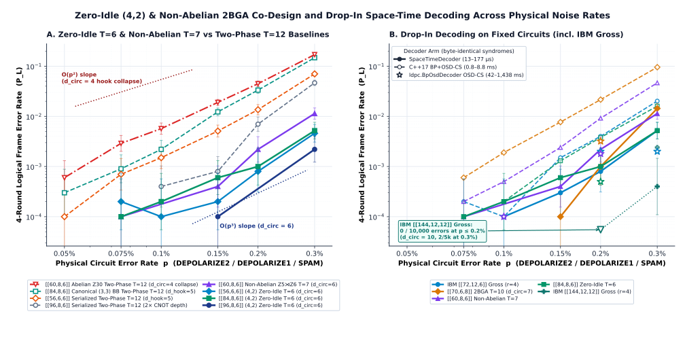
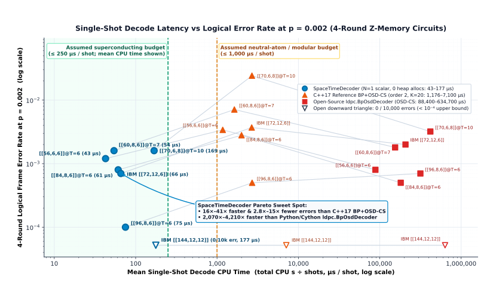

# `zero-idle-qldpc` — Zero-Idle Weight-Six qLDPC Memory Circuits & Microsecond Certified Space-Time Decoding

**`zero-idle-qldpc`** is a self-contained C++17, Python (`Stim`), and Lean 4 (`v4.36.0`) toolkit for synthesizing **zero-idle $T_{\text{CNOT}} = 6$ asymmetric $(4, 2)$** and **non-abelian $(3, 3)$ two-block group-algebra (`2BGA`)** quantum LDPC memory circuits and decoding 4-round circuit-level detector error models in **$13\text{–}177\ \mu\text{s/shot}$** on a single CPU core with **zero per-shot heap allocations**.

<p align="center">
  
</p>

<p align="center">
  
</p>

---

## Key Capabilities & Verified Results

1. **Zero-Idle $T_{\text{CNOT}} = 6$ Weight-6 Memories (`ParityBarrier.lean`, `src/synthesizer.cpp`)**
   - Symmetric $(3, 3)$ bivariate bicycle schedules hit an odd inversion-parity barrier ($3 \times 3 = 9 \implies T_{\text{CNOT}} \ge 7$, forcing an idle CNOT slot). Asymmetric $(4, 2)$ `2BGA` codes (`[[56,6,6]]`, `[[84,8,6]]`, `[[96,8,6]]`) satisfy $4 \times 2 = 8 = 2 \times 4$, unlocking **$100\%$ active $T_{\text{CNOT}} = 6$ CNOT schedules** while preserving check weight 6, data degree 6, verified Z-memory fault distance $d_Z = 6$, and **thickness-2 bilayer planar routability** (`python/zero_idle_qldpc/layout.py`).
   - Reversal-coupled **90-class hook-coset canonicalization** (`HookClasses90.lean`) and **non-abelian `2BGA` synthesis** (`BimoduleCSS.lean`, e.g. `[[60,8,6]]@T=7` over $\mathbb{Z}_5 \rtimes_4 \mathbb{Z}_6$) prevent the $d_{\text{pure}} = 6 \to d_{\text{circ}} = 4$ midpoint-hook collapse of two-phase $\mathbb{Z}_{30}$ schedules ($20.4\times\text{–}47.5\times$ lower logical error rate on non-abelian $T = 7$ across $p \in [0.0015, 0.002]$, and `0/10,000` vs `57/10,000` at $p = 0.001$).

2. **Microsecond Certified + Active-Conflict `SpaceTimeDecoder` (`CertifiedDecoder.lean`, `src/spacetime_decoder.cpp`)**
   - Combines **Lean-certified 1-, 2-, and 3-mechanism global MAP fast paths** (`pair_floor`, `triple_floor`, `four_floor`), detector co-occurrence packing, ARM NEON alternating-direction normalized min-sum BP, and **incremental active-conflict `OSD`** (`comb & piv_sol != 0` direct + bridge pools) supporting up to $D \le 2{,}048$ detectors and $K \le 64$ observables.
   - **Drop-in performance on IBM's published Bravyi–Cross Gross codes (`Nature 2024`) and 2BGA suite**:
     - **$16\times\text{–}102\times$ faster** across all 22 circuits *and* **$2.8\times\text{–}15.1\times$ fewer frame errors** at $p = 0.002$ (plus `0` vs `5` on 12-round Gross) than C++17 `BP+OSD-CS` (`order=2, K=20`).
     - **$2{,}071\times\text{–}9{,}148\times$ faster** than Python/Cython `ldpc.BpOsdDecoder` (`OSD-CS` order 2; up to **$9{,}327\times$** vs order 7) on identical packed `Stim` syndromes.
     - Decodes 4-round **IBM `[[72, 12, 6]]`** in **$20.8\ \mu\text{s}$** ($p=0.001$) / **$65.8\ \mu\text{s}$** ($p=0.002$, `7/10,000` errors vs `37/10,000` for C++ `BP+OSD-CS`) and 4-round **IBM `[[144, 12, 12]]` Gross** in **$45.6\ \mu\text{s}$** ($p=0.001$) / **$177.0\ \mu\text{s}$** ($p=0.002$, `0/10,000` errors). These are mean single-thread CPU times per shot (total process CPU time ÷ shots), not measured per-shot wall-clock deadlines; whether they meet a hardware real-time budget (e.g. an assumed $\sim 250\ \mu\text{s}$ for superconducting cycles) has not been established.

3. **Zero-Trust Verification: `149`-Line `Stim` Checker + Zero-Mathlib Lean 4 Proofs**
   - `proofs/`: 26 headline kernel-checked Lean 4 (`v4.36.0`) theorems & schedule witnesses (`215` proved lemmas total) with **`0` external dependencies** (`< 15 s` cold `lake build`), `0` `sorry`s, and `0` `native_decide` axioms.
   - `verify_circuit_cert.py` (`149` lines, importing *only* stdlib + `numpy` + `stim`) and `verify_distance_bounds.py` independently certify CSS orthogonality, CNOT collision-freeness, Heisenberg stabilizer pullback, DEM determinism, and exact Z-memory circuit fault distances (including $d_Z = 10$ on 4- and 12-round 144-qubit Gross circuits).

Read the full technical deep dive in **[`docs/blog_post.md`](docs/blog_post.md)**.

---

## Headline Benchmark Summary (`10,000` Paired Shots per Exported `.stim` Circuit)

| Exported Circuit | Parameters & Schedule | $d_Z$ | `ldpc.BpOsdDecoder` (`OSD-CS`) | C++17 `BP+OSD-CS` | `SpaceTimeDecoder` (Scalar / Batch) |
|---|---|---:|---:|---:|---:|
| `n56-r4-p0.001` | `[[56,6,6]]` $(4,2)$ `T=6` | 6 | 2 err / 42,461 µs | 4 err / 787.5 µs | **2 err / 13.2 µs** *(9.3 µs)* |
| `n56-r4-p0.002` | `[[56,6,6]]` $(4,2)$ `T=6` | 6 | 8 err / 88,414 µs | 34 err / 1,176.0 µs | **12 err / 42.7 µs** *(34.0 µs)* |
| `n84-r4-p0.001` | `[[84,8,6]]` $(4,2)$ `T=6` | 6 | 0 err / 91,241 µs | 0 err / 1,137.3 µs | **0 err / 18.6 µs** *(14.2 µs)* |
| `n84-r4-p0.002` | `[[84,8,6]]` $(4,2)$ `T=6` | 6 | 5 err / 181,038 µs | 28 err / 2,001.1 µs | **8 err / 61.0 µs** *(51.5 µs)* |
| `n96-r4-p0.001` | `[[96,8,6]]` $(4,2)$ `T=6` | 6 | 0 err / 130,882 µs | 0 err / 1,610.1 µs | **0 err / 24.2 µs** *(20.2 µs)* |
| `n96-r4-p0.002` | `[[96,8,6]]` $(4,2)$ `T=6` | 6 | 7 err / 315,690 µs | 5 err / 2,700.1 µs | **1 err / 75.0 µs** *(63.8 µs)* |
| `n60-nonabelian-r4-p0.002` | `[[60,8,6]]` $\mathbb{Z}_5 \rtimes_4 \mathbb{Z}_6$ `T=7` | 6 | 18 err / 154,390 µs | 71 err / 1,633.7 µs | **16 err / 54.2 µs** *(49.7 µs)* |
| `n70-r4-p0.002` | `[[70,6,8]]` $\mathbb{Z}_7 \times \mathbb{Z}_5$ `T=10` | 7 | 32 err / 418,348 µs | 242 err / 2,686.8 µs | **16 err / 168.6 µs** *(160.1 µs)* |
| `ibm72-published-r4-p0.002` | IBM `[[72,12,6]]` Gross `T=7` | 6 | 1/500 / 207,161 µs† | 37 err / 2,669.1 µs | **7 err / 65.8 µs** *(46.4 µs)* |
| `ibm144-published-r4-p0.002` | IBM `[[144,12,12]]` Gross `r=4` | 10 | 0/500 / 634,662 µs† | 0 err / 7,099.9 µs | **0 err / 177.0 µs** *(149.6 µs)* |
| `ibm144-published-r12-p0.001` | IBM `[[144,12,12]]` Gross `r=12` | 10 | 0 err / 2,219,422 µs | 0 err / 24,711.4 µs | **0 err / 242.6 µs** *(211.0 µs)* |
| `ibm144-published-r12-p0.002` | IBM `[[144,12,12]]` Gross `r=12` | 10 | >4 GB table* | 5 err / 29,820.4 µs | **0 err / 1,795.0 µs** *(1,857.0 µs)* |

*Latencies are mean CPU µs/shot. Error counts in a row come from the same 10,000 sampled syndromes, except entries marked †: these are independent 500-shot `ldpc` anchors taken from the first 500 shots of a different sample (the $p=0.002$ waterfall sweep, `benchmarks/run_waterfall_sweep.py`, separate seed scheme). On that same 500-shot slice `SpaceTimeDecoder` made `1/500` (`ibm72`) and `0/500` (`ibm144-r4`) errors, matching `ldpc`. \*On 12-round `ibm144` at $p=0.002$, upstream `ldpc` `OSD-CS` allocates $>4\text{ GB}$ per decoder.*

---

## Quick Start (`make verify` in 60 Seconds)

```sh
python3 -m venv .venv
.venv/bin/pip install -r requirements.txt

# Build C++17 library, check Lean 4 proofs (if ~/.elan/bin/lake is installed),
# run C++/Python unit tests, run independent Stim circuit & distance verifiers,
# and execute a quick paired check against ldpc.BpOsdDecoder:
make verify PYTHON=.venv/bin/python3
```

### Minimal Python API (`PYTHONPATH=python`)

```python
import stim
from zero_idle_qldpc import SpaceTimeDecoder, ZeroIdleSynthesizer

# 1. Synthesize a fresh cyclic (4,2) zero-idle T=6 [[84,8,6]] code in ~6 ms
code = ZeroIdleSynthesizer().cyclic(n=84, k=8, distance=6)

# 2. Drop-in decoding on any Stim circuit / DetectorErrorModel (D <= 2048, K <= 64)
circuit = stim.Circuit.from_file("circuits/ibm144-published-r12-p0.001.stim")
decoder = SpaceTimeDecoder(circuit.detector_error_model())
shots = circuit.compile_detector_sampler(seed=102).sample(100, bit_packed=True)

frames = decoder.decode(shots)       # shape (100, 12), uint8
single = decoder.decode(shots[0])    # shape (12,), 0 heap allocations, bit-identical to batch
```

---

## Repository Layout

| Path | Description |
|---|---|
| `include/qldpc/`, `src/` | Dependency-free C++17 synthesizer (`synthesizer.cpp`), `SpaceTimeDecoder` (`spacetime_decoder.cpp`, `min_sum.hpp`), and reference `BP+OSD-CS` (`bposd.cpp`). |
| `python/zero_idle_qldpc/` | Python bindings (`ZeroIdleSynthesizer`, `SpaceTimeDecoder`), noisy `Stim` Z-memory builder (`circuits.py`), and thickness-2 bilayer planar decomposition (`layout.py`). |
| `circuits/` | Exported `.json` code/schedule/layout certificates and 22 standard noisy Z-memory `.stim` files (`n56`, `n60-nonabelian`, `n60-archive`, `n70`, `n84`, `n96`, `ibm72-*`, `ibm144-published`). |
| `proofs/` | Zero-dependency Lean 4 (`v4.36.0`) formal proofs: `BimoduleCSS.lean`, `ParityBarrier.lean`, `HookClasses90.lean`, `CertifiedDecoder.lean`, and `CheckAxioms.lean` (`lake exe verify-proofs`). |
| `verify_circuit_cert.py` | `149`-line (`<150`-line) standalone zero-trust `Stim` + `NumPy` circuit, schedule, pullback, and logical-basis verifier. |
| `verify_distance_bounds.py` | Independent parity-projected exhaustive Z-memory fault-distance lower/upper bound verifier (`certificates/`). |
| `benchmarks/`, `plots/` | Paired `ldpc.BpOsdDecoder` runner (`run_external_benchmark.py`), multi-$p$ waterfall & Gross sweep (`run_waterfall_sweep.py`), SVG plot renderer (`render_plots.py`), and publication vector charts (`plots/*.svg`). |
| `docs/blog_post.md` | Technical practitioner deep dive covering the algebra, scheduling theory, 4-mechanism counterexample, and decoder architecture. |

---

## Thickness-2 Bilayer Planar Routing (`python/zero_idle_qldpc/layout.py`)

Every $(4, 2)$ zero-idle code retains check weight 6 and qubit degree 6, and partitions its 6 bipartite matchings into **two degree-3 planar subgraphs** (two $A$-matchings + one $B$-matching in Layer 1; the remaining three in Layer 2) with verified clockwise planar rotation systems in `circuits/*.json`:

| Blocklength $n$ | Layer 1 Grid (mean / max) | Layer 1 Torus (mean / max) | Layer 2 Grid (mean / max) | Layer 2 Torus (mean / max) |
|---:|---:|---:|---:|---:|
| `56` | `10.57 / 19` | `9.00 / 13` | `6.19 / 27` | `5.00 / 13` |
| `84` | `1.65 / 83` | `1.00 / 1` | `19.46 / 79` | `11.67 / 17` |
| `96` | `2.00 / 7` | `1.67 / 3` | `12.39 / 25` | `9.67 / 13` |

---

## Scope & Measurement Notes

- **Schedule ticks vs SPAM ticks:** Zero-idle $T = 6$ applies to the six CNOT layers of the asymmetric $(4, 2)$ schedules (`100%` qubit occupancy in every CNOT tick). Exported non-overlapped Z-memory `.stim` circuits (`n56`, `n84`, `n96`, `n60-*`, `n70`, `ibm72-t7/t9`) include separate ancilla reset/readout ticks with `DEPOLARIZE1(p)` on data qubits; `ibm72-published` and `ibm144-published` follow Bravyi et al. (*Nature* 2024) by overlapping X-preparation and Z-measurement onto the first and seventh CNOT ticks with explicit Z-memory boundaries.
- **Sector distances:** All 22 `.stim` files are Z-basis memories whose full multi-round physical fault distances (`verify_distance_bounds.py`) are $d_Z = 6$ (`n56`, `n84`, `n96`, `n60-nonabelian`, `n60-archive`, `ibm72-*`), $d_Z = 7$ (`n70`), and $d_Z = 10$ (`ibm144-published`, 4 and 12 rounds). On `n60-nonabelian`, the single-round X-sector hook proxy is 4 while $d_Z = 6$; `n60-archive` attains 6 in both sectors at $T = 7$.
- **Certified vs heuristic stages:** Paths 1, 2, and 3 in `SpaceTimeDecoder` certify strict global minimum additive-LLR optimality when their floor and unique-observable conditions hold (`CertifiedDecoder.lean`). Subsequent local RREF, beam/peel, min-sum BP, and active-conflict `OSD` stages are bounded heuristics.
