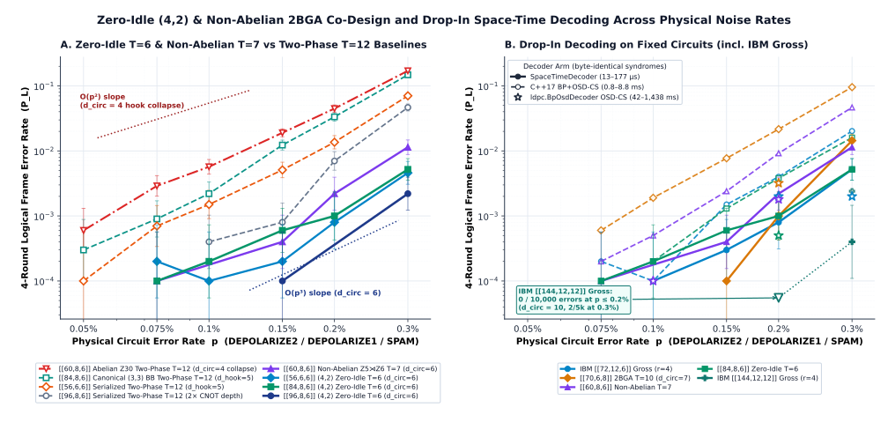
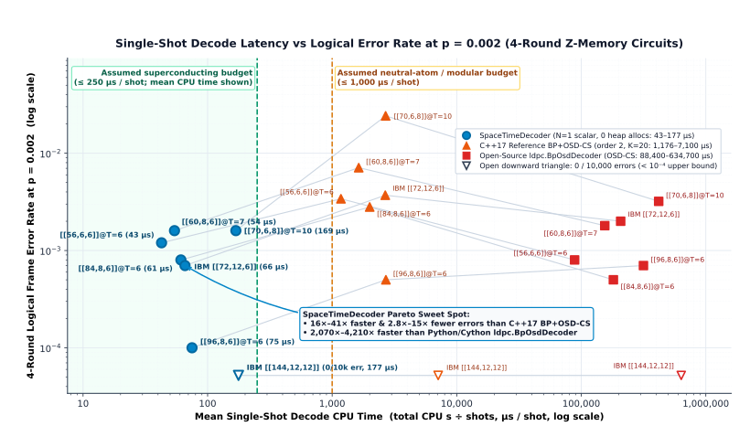

# Zero-Idle Weight-Six qLDPC Memories and Microsecond Certified Space-Time Decoding

## 1. The 30-Second Result

Weight-six two-block quantum LDPC (qLDPC) memories—including bivariate bicycle (BB) codes $H_X = [A \mid B]$, $H_Z = [B^T \mid A^T]$—hit two concrete walls in circuit-level operation:

1. **The $(3,3)$ CNOT parity barrier and hook collapse.** Every universal shift-homogeneous CNOT schedule for a $(3,3)$ code requires $T_{\text{CNOT}} \ge 7$ ticks (`ParityBarrier.no_symmetric_3_3_depth_6`), forcing an idle CNOT slot per round. Worse, serialized ($T = 12$) or unscreened schedules let mid-check ancilla faults propagate into weight-2 or weight-3 data errors, collapsing static distance $d = 6$ to circuit distance $d_{\text{circ}} = 4$.
2. **Decode latency and quantum degeneracy traps.** On circuit-level detector error models (DEMs) with $M = 7{,}784\text{–}67{,}752$ mechanisms, Python/Cython `ldpc.BpOsdDecoder` (`OSD-CS`) requires $42\text{–}2{,}219\text{ ms/shot}$, while C++17 flooding `BP+OSD-CS` requires $0.8\text{–}30\text{ ms/shot}$ and degrades when $3 + 3 = 6$ degeneracy ties stall message passing.

`zero-idle-qldpc` pairs an asymmetric $(4,2)$ and non-abelian two-block group-algebra (`2BGA`) circuit synthesizer with `SpaceTimeDecoder`, a zero-allocation C++17 DEM decoder combining Lean-certified 1-/2-/3-fault fast paths with active-conflict `OSD`. All four core algebraic, scheduling, hook-equivalence, and certificate modules (`26` headline theorems & schedule witnesses, `215` proved lemmas total) compile in `< 15 s` in Lean 4 (`v4.36.0`, zero Mathlib dependencies, `0` `sorry`s), and a `149`-line (`< 150`-line) standalone `Stim` script (`verification/verify_circuits.py`) plus `verification/verify_distances.py` independently check every circuit.


*Figure 1 (`docs/figures/waterfall_ler.svg`): **Panel A:** 4-round Z-memory frame error rate across $p \in [0.05\%, 0.3\%]$ for zero-idle $(4,2)$ $T=6$ (`[[56,6,6]]`, `[[84,8,6]]`, `[[96,8,6]]`) and non-abelian `[[60,8,6]]@T=7` ($O(p^3)$, $d_{\text{circ}} = 6$) vs $T=12$ two-phase baselines and canonical $\mathbb{Z}_{30}$ hook collapse ($O(p^2)$, $d_{\text{circ}} = 4$). **Panel B:** Drop-in decoding on identical `Stim` syndromes, including IBM's `[[72,12,6]]` and `[[144,12,12]]` Gross codes.*


*Figure 2 (`docs/figures/latency_accuracy_pareto.svg`): Single-shot ($N=1$ scalar) CPU latency vs 4-round frame error rate at $p = 0.002$. All 4-round circuits—including IBM's `[[72,12,6]]` and `[[144,12,12]]` Gross codes—average $43\text{–}177\ \mu\text{s/shot}$ of single-thread CPU time (total process CPU time ÷ shots). The shaded $250\ \mu\text{s}$ and $1{,}000\ \mu\text{s}$ lines are assumed reference budgets, not measured hardware timing contracts; per-shot wall-clock deadline compliance has not been established.*

### Paired 10,000-Shot Benchmark on Exported `.stim` Circuits

Within each row, the `SpaceTimeDecoder` and C++17 `BP+OSD-CS` arms decode byte-identical packed `Stim` syndromes (10,000 shots) on the full correlated DEM, as does `ldpc` except in the rows marked † (`benchmarks/run_external_benchmark.py`, `benchmarks/results/full_benchmark.json`, `benchmarks/results/waterfall_results.json`). Scalar ($N=1$) and shuffled-batch calls produce bit-identical predictions across all circuits.

| Circuit (`.stim`) | Code & Schedule | $d_Z$ | `ldpc` `OSD-CS` (ord 2) | C++17 `BP+OSD-CS` | `SpaceTimeDecoder` Scalar *(Batch)* | Speedup vs C++ / `ldpc` |
|---|---|---:|---:|---:|---:|---:|
| `n56-r4-p0.002` | `[[56,6,6]]` $(4,2)$ `T=6` | 6 | 8 / 88,414 µs | 34 / 1,176 µs | **12 / 42.7 µs** *(34.0)* | **27.5× / 2,071×** |
| `n84-r4-p0.002` | `[[84,8,6]]` $(4,2)$ `T=6` | 6 | 5 / 181,038 µs | 28 / 2,001 µs | **8 / 61.0 µs** *(51.5)* | **32.8× / 2,968×** |
| `n96-r4-p0.002` | `[[96,8,6]]` $(4,2)$ `T=6` | 6 | 7 / 315,690 µs | 5 / 2,700 µs | **1 / 75.0 µs** *(63.8)* | **36.0× / 4,209×** |
| `n60-nonabelian-r4-p0.002` | `[[60,8,6]]` $\mathbb{Z}_5 \rtimes_4 \mathbb{Z}_6$ `T=7` | 6 | 18 / 154,390 µs | 71 / 1,634 µs | **16 / 54.2 µs** *(49.7)* | **30.1× / 2,848×** |
| `n70-r4-p0.002` | `[[70,6,8]]` $\mathbb{Z}_7 \times \mathbb{Z}_5$ `T=10` | 7 | 32 / 418,348 µs | 242 / 2,687 µs | **16 / 168.6 µs** *(160.1)* | **15.9× / 2,481×** |
| `ibm72-published-r4-p0.002` | IBM `[[72,12,6]]` Gross `T=7` | 6 | 1/500 / 207,161 µs† | 37 / 2,669 µs | **7 / 65.8 µs** *(46.4)* | **40.6× / 3,148×** |
| `ibm144-published-r4-p0.002` | IBM `[[144,12,12]]` Gross `r=4` | 10 | 0/500 / 634,662 µs† | 0 / 7,100 µs | **0 / 177.0 µs** *(149.6)* | **40.1× / 3,586×** |
| `ibm144-published-r12-p0.001` | IBM `[[144,12,12]]` Gross `r=12` | 10 | 0 / 2,219,422 µs | 0 / 24,711 µs | **0 / 242.6 µs** *(211.0)* | **101.9× / 9,148×** |
| `ibm144-published-r12-p0.002` | IBM `[[144,12,12]]` Gross `r=12` | 10 | >4 GB table* | 5 / 29,820 µs | **0 / 1,795.0 µs** *(1,857)* | **16.6× / —** |

*\*At $p = 0.001$, scalar latency drops to $13.2\text{–}45.6\ \mu\text{s/shot}$ across all 4-round memories (`n56`: $13.2\ \mu\text{s}$, `n84`: $18.6\ \mu\text{s}$, `n96`: $24.2\ \mu\text{s}$, `ibm72`: $20.8\ \mu\text{s}$, `ibm144-r4`: $45.6\ \mu\text{s}$). Latencies are mean CPU µs/shot. †The `ibm72`/`ibm144-r4` `ldpc` entries are independent 500-shot anchors: the first 500 shots of a different sample (the $p=0.002$ waterfall sweep, `benchmarks/run_waterfall_sweep.py`, separate seed scheme), so their error counts are not paired with the 10,000-shot columns. On that same 500-shot slice `SpaceTimeDecoder` made `1/500` (`ibm72`) and `0/500` (`ibm144-r4`) errors, matching `ldpc`; their speedup ratios compare mean latencies across the two samples. On 12-round `ibm144` ($M=67{,}752$), upstream `ldpc` `OSD-CS` allocates $>4\text{ GB}$ per decoder.*

---

## 2. Why $3 \times 3 = 9$ Forces an Idle Tick and $4 \times 2 = 8$ Unlocks Zero-Idle $T = 6$

### Non-Abelian Bimodule CSS Orthogonality and the Parity Barrier

Over any finite group $G$ of order $m$, left multiplication $L_a(x) = ax$ and right multiplication $R_b(x) = xb$ commute by associativity $(ax)b = a(xb)$ with no commutativity assumption on $G$. Supports $A, B \subseteq G$ with $|A| + |B| = 6$ define weight-6 CSS matrices $H_X = [L(A) \mid R(B)]$ and $H_Z = [R(B)^T \mid L(A)^T]$ satisfying $H_X H_Z^T = 0 \pmod 2$ (`BimoduleCSS.left_right_comm`, `BimoduleCSS.css_orthogonality`).

Assigning CNOT ticks $t_A \in \text{Fin}(T)^{w_A}$, $t_B \in \text{Fin}(T)^{w_B}$ (X-checks) and $t_{BT} \in \text{Fin}(T)^{w_B}$, $t_{AT} \in \text{Fin}(T)^{w_A}$ (Z-checks) requires pairwise disjointness of $(t_A, t_B)$, $(t_{BT}, t_{AT})$, $(t_A, t_{BT})$, and $(t_B, t_{AT})$. Because X-check $x$ and Z-check $z$ share Left qubit $a_i x = z b_j^{-1}$ iff $z = a_i x b_j$ iff they share Right qubit $x b_j = a_i^{-1} z$, universal Heisenberg stabilizer commutation reduces to:

$$\forall i \in \text{Fin}(w_A),\ \forall j \in \text{Fin}(w_B): \quad \mathbf{1}[t_{A,i} < t_{BT,j}] = \mathbf{1}[t_{B,j} < t_{AT,i}].$$

At the zero-idle degree bound $T = w_A + w_B = 6$, tick disjointness forces $\text{im}(t_{BT}) = \text{im}(t_B)$ and $\text{im}(t_{AT}) = \text{im}(t_A)$. Every pair $(i, j)$ satisfies $\mathbf{1}[t_{A,i} < t_{B,j}] + \mathbf{1}[t_{B,j} < t_{A,i}] = 1$, so summing over all $w_A w_B$ pairs yields (`ParityBarrier.zero_idle_inversion_double_eq_prod`):

$$2 N = w_A w_B, \qquad N := \sum_{i, j} \mathbf{1}[t_{A,i} < t_{BT,j}].$$

- **$(3, 3)$ impossibility at $T = 6$ (`ParityBarrier.no_symmetric_3_3_depth_6`):** $w_A w_B = 9$ is odd, so $2N = 9$ is impossible; $T_{\text{CNOT}} = 7$ is tight (`mirror_3_3_depth_7`).
- **$(4, 2)$ zero-idle $T = 6$ (`ParityBarrier.zero_idle_4_2_depth_6`):** $w_A w_B = 8 = 2 \times 4$. Setting $t_A = (0, 2, 3, 5)$, $t_B = (4, 1)$, $t_{BT} = (1, 4)$, $t_{AT} = (5, 3, 2, 0)$ yields $100\%$ active CNOT ticks (`zero_idle_4_2_all_ticks_active`). *(Zero-idle applies to the 6 CNOT ticks; non-overlapped Z-memories still apply `DEPOLARIZE1(p)` on data qubits during separate ancilla reset/readout ticks.)*

Asymmetric $(4, 2)$ codes keep check weight 6, qubit degree 6, and **thickness-2 bilayer routability**: `python/zero_idle_qldpc/layout.py` partitions the six matchings into two verified planar 3-regular graphs (`2A + 1B` and `2A^T + 1B^T` / remaining three matchings; e.g., `n=84` torus wire length mean/max is `1.00 / 1` on Layer 1 and `11.67 / 17` on Layer 2). Across `[[56,6,6]]`, `[[84,8,6]]`, and `[[96,8,6]]`, zero-idle $T = 6$ cuts 4-round frame errors at $p = 0.002$ by **$12.4\times\text{–}17.0\times$** (plus `0/5k` vs `35/5k` on `n=96`) versus serialized $T = 12$ two-phase schedules (`4/5k` vs `68/5k`, `5/5k` vs `62/5k`, `0/5k` vs `35/5k`).

### 90 Hook-Equivalence Classes and Non-Abelian `[[60, 8, 6]]`

Over $S_6$ ($720$ gate orders of a weight-6 check), bare suffix hooks modulo $111111_2$ form **360** classes (`HookClasses90.bare_hook_classes_eq_360`). Adjoining the always-present single-qubit data faults $\{[e_u]\}_{u=0}^5$ absorbs $[h_1]$ and $[h_5]$ and collapses $S_6$ to **exactly 90** fault sets (`HookClasses90.augmented_hook_classes_eq_90`), characterized by the reversal-coupled key (`coset90_key_sound_and_complete`):

$$\text{coset90Key}(p) = \min\!\Big((\{p_0,p_1\}, p_2, p_3, \{p_4,p_5\}),\ (\{p_4,p_5\}, p_3, p_2, \{p_0,p_1\})\Big).$$

Sorting $(p_2, p_3)$ without reversing the end pairs collapses 90 classes to 45, falsely aliasing $\{p_0,p_1,p_2\}$ with $\{p_0,p_1,p_3\}$ and leaking weight-4 hook errors. At $n = 60$ ($m = 30 = 2 \cdot 3 \cdot 5$), every 2D abelian torus is cyclic $\mathbb{Z}_{30}$; canonical two-phase `[A,A,A,B,B,B]` extraction collapses $d_{\text{pure}} = 6 \to d_{\text{circ}} = 4$ (`57/10,000` errors at $p=0.001$; `224/5,000` at $p=0.002$). Lifting to non-abelian $\mathbb{Z}_5 \rtimes_4 \mathbb{Z}_6$ (`circuits/n60-nonabelian*.stim`, verified Z-memory distance $d_Z = 6$, X-sector single-round proxy 4) or 90-class $T = 7$ scheduling (`circuits/n60-archive*.stim`, $d_{\text{hook}} = 6$) restores $O(p^3)$ suppression (`0/10,000` at $p=0.001$; `11/5,000` and `3/5,000` at $p=0.002$).

---

## 3. Why Textbook Speedups Fail on `3 + 3 = 6` Ties, and How `SpaceTimeDecoder` Beats `OSD-CS`

Two standard classical LDPC speedups fail on $d_{\text{circ}} = 6$ quantum codes:

1. **Unchecked sequential Gauss-Seidel BP.** On a $d_{\text{circ}} = 6$ DEM, weight-3 faults tie against weight-3 logical complements ($3 + 3 = 6$). Fixed-index serial sweeps break symmetry by detector numbering rather than LLR cost, locking onto wrong logical cosets or skewing OSD column rankings.
2. **Wide coset-sum windows and uncertified local slack.** Summing $\sum \exp(-\Delta C)$ over wide windows lets combinatorial weight-4/5 swarms outvote a weight-3 minimum, while accepting a local restricted OSD solve via a heuristic slack gate *before* global low-weight checks breaks minimum-weight optimality.

### The Blind-Review 4-Mechanism Counterexample (`3.0 vs 2.7`)

In blind review, two referees exhibited a 4-detector, 4-mechanism oracle (`tests/test_package.py::test_minimum_cost_triple`; `CertifiedDecoder.counterexample_30_vs_27_restricted_slack_fails` with $\times 10$ integer weights): target syndrome $s = \{0, 1\}$; $m_0 = \{0, 1\}$ at cost $3.0$ (observable $0$); $m_1 = \{0, 2\}$, $m_2 = \{1, 3\}$, $m_3 = \{2, 3\}$ at cost $0.9$ each (observables $1, 0, 0$). Because $m_3 = \{2, 3\}$ touches neither fired detector, the restricted local tile $\{m_0, m_1, m_2\}$ admits only $\{m_0\}$, passes slack gate $3.0 \le 1.0 + 3(0.9) = 3.7$, and outputs $0$ instead of the global optimum $\{m_1, m_2, m_3\}$ at cost $2.7$ (observable $1$).

### Certified Paths 1–3 + Symmetry-Safe BP + Active-Conflict OSD

`cpp/src/spacetime_decoder.cpp` runs with **zero per-shot heap allocations** (`tests/native.cpp`) in three stages:

1. **Lean-Certified 1-/2-/3-Fault Global MAP Paths (`CertifiedDecoder.lean`).** Using sorted minimum LLRs $w_{(0)} \le w_{(1)} \le w_{(2)} \le w_{(3)}$ (`pair_floor`, `triple_floor`, `four_floor`, proved lower bounds via `kSmallestSum_le_subsetWeight`):
   - **Path 1 (`path1_certified_map`):** O(1) SplitMix64 hash lookup of $s$, certified optimal if $c^* < \text{pair\_floor}$ with unique observable.
   - **Path 2 (`pair_anchor_complete`, `path2_certified_map`):** Scans $m_1 \in \text{adj}(d_0)$ at a fired detector $d_0 \in s$ and hashes $s \oplus \text{col}(m_1)$; certified optimal if $c^* < \text{triple\_floor}$.
   - **Path 3 (`triple_anchor_pivot_complete`, `path3_certified_map`):** Anchors $a \in \text{adj}(d_{\text{rarest}}(s))$, pivots on the rarest fired bit of $s \oplus \text{col}(a)$, and hashes the complement; certified optimal if $c^* < \text{four\_floor}$. On the `3.0 vs 2.7` witness, `triple_floor = 2.7` blocks $\{m_0\}$ ($3.0 \not< 2.7$) and `four_floor = 5.7` certifies $\{m_1, m_2, m_3\}$ ($2.7 < 5.7$) across all $24/24$ column permutations.
2. **Local Peel/Beam & Alternating-Direction NEON BP.** Uncertified $\ge 4$-fault syndromes try stack-allocated local RREF (`quick_osd`) and contained-column peeling + width-5 beam (`peel`), then run ARM NEON normalized damped min-sum BP (`cpp/src/min_sum.hpp`) with **alternating forward/reverse detector sweeps** (`rev = (it & 1) != 0`) and O(1) hash 2-to-1 triangle contraction.
3. **Incremental Active-Conflict OSD (`run_active_conflict_osd`).** Standard `OSD-CS` reduces all $M$ columns across all $D$ rows and sweeps non-pivot pairs whose pivot representation `comb` often has zero overlap (`comb & piv_sol == 0`) with the active pivot support `piv_sol`. `SpaceTimeDecoder` reduces `s_rem` online as pivots arrive, **stops Gaussian elimination** once `s_rem == 0` and `k_scan_cap` non-pivots are found, and restricts order-2/3 sweeps to `direct_pool` (`comb & piv_sol != 0`) plus 1-step `bridges`. On `n70-r4-p0.002`, this cuts frame errors from `242` (C++ `CS2`) and `32` (`ldpc` `CS2`/`CS7`) to **`16`** at $168.6\ \mu\text{s/shot}$ (`2,481×` faster than `ldpc`); on IBM's `[[72,12,6]]` and `[[144,12,12]]` Gross codes, it achieves `7` vs `37` errors ($65.8\ \mu\text{s}$) and `0/10,000` errors ($177.0\ \mu\text{s}$ at $r=4$; `0` vs `5` at $r=12, p=0.002$).

---

## 4. Don't Trust Us — Run `make verify` in 60 Seconds

```sh
# 1. Kernel-check all 26 headline Lean 4 theorems & witnesses (< 15 s cold build, 0 Mathlib deps, 0 sorrys)
cd proofs && lake clean && time lake build && lake exe verify-proofs
rg 'sorry|admit|native_decide|\baxiom\b' *.lean ZeroIdleQldpc/*.lean || echo "0 unproved axioms"
cd ..

# 2. Build C++17 library (-Wall -Wextra -Werror), verify 0 scalar heap allocations,
#    24/24 permutations of 3.0 vs 2.7, standalone 149-line Stim circuit verifier
#    (verification/verify_circuits.py), exhaustive Z-memory distance bounds (verification/verify_distances.py,
#    certifying d_Z = 10 on 144-qubit Gross), and quick paired ldpc check:
make verify

# 3. Reproduce the full 10,000-shot ldpc benchmark, multi-p sweep, and SVG plots:
make benchmark-full
python3 benchmarks/run_waterfall_sweep.py
python3 benchmarks/render_plots.py
```

`verification/verify_circuits.py` imports **zero** code from `zero_idle_qldpc` (enforced by `test_checker_has_no_local_imports`: stdlib + `numpy` + `stim` only, `149` lines), independently checking `H_X @ H_Z.T == 0 mod 2`, degree 6, CNOT collision-freeness, Heisenberg pullback, deterministic DEMs, and constructive `Stim` logical witnesses across all 22 `.stim` files.
